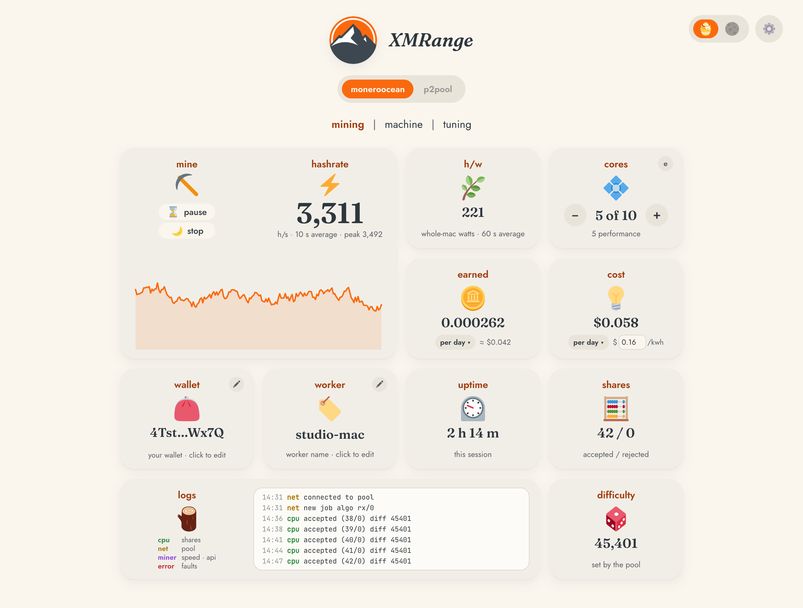

# What XMRange is

XMRange is a Mac app that mines Monero (XMR) on your CPU. It has one goal: the most hashes for every watt your Mac spends.

It runs on Apple Silicon Macs. A separate build runs on Intel Macs. Everything stays on your Mac, and it never asks for an administrator password.

<!-- screenshot: the main window on the mining tab, mining, showing the hashrate, h/w, cores and wallet cards -->

## Who it is for

You have a Mac. You want to see what it can do, quietly, and you want to know what it costs you. XMRange shows the electricity next to the earnings, so you can judge for yourself.

## What it does

- **It measures instead of guessing.** "run trials" tries each setup on your own Mac and records the hashes per watt. Results stay on the Mac.
- **It gives you three profiles from those trials.**
  - **quiet:** a few cores at background priority.
  - **balanced:** about half of the cores, at the best hashes per watt.
  - **max:** every core.
- **It offers two pools.**
  - **moneroocean:** the simple way to start.
  - **p2pool:** no pool operator. It needs a Monero node, either the one the Monero GUI runs or one that XMRange runs for you.
- **It uses Tor by default.** The pool sees a Tor exit, not your IP address. You can turn this off.
- **It can pause itself.** Above a CPU temperature you choose, or while the Mac is on battery.

## What is on the screen

Three tabs: **mining**, **machine** and **tuning**. A pool switch at the top. A gear for settings, and a button for light and dark.

## What it does not do

It sends no telemetry and no crash reports. It does not use sudo. It is a native window, not a website.

The license is GPL-3.0-or-later. The code is open.

Next: [Install](02-install.md).
