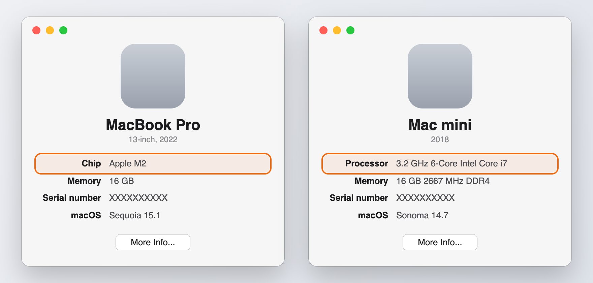
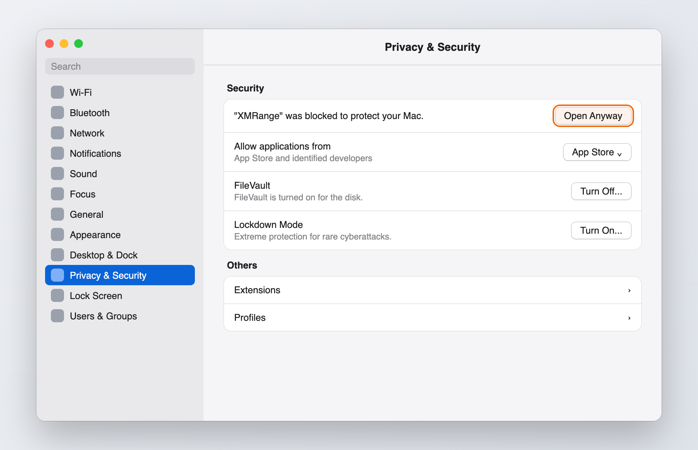

# Install

## 1. Download

Go to the releases page: https://github.com/House-of-Helios/xmrange/releases

Each release has two disk images. Pick the one that matches your Mac.

- `XMRange-apple-silicon.dmg` for Macs with an Apple chip (M1 and later).
- `XMRange-intel.dmg` for Macs with an Intel processor.

The zips beside them are for the app's own updater. You don't need them.

The two apps are separate. Each one only updates to its own kind.

### Which Mac do I have?

Open the Apple menu and choose **About This Mac**.

- If you see **Chip** followed by a name like "Apple M2", take apple-silicon.
- If you see **Processor** followed by a name like "Intel Core i5", take intel.

<!-- screenshot: About This Mac showing the Chip line, and beside it one showing the Processor line -->

## 2. Check the download (optional)

Beside each disk image sits a file with the same name ending in `.sha256`. It holds the disk image's checksum. In Terminal, `shasum -a 256 <the .dmg>` prints the checksum of your copy. The two should match.

## 3. Move it to Applications

Open the disk image. Drag XMRange onto the Applications folder beside it. Then eject the disk image.

## 4. Why macOS hesitates

Apple has not signed XMRange, so macOS stops the first open. This is expected. The app is ad-hoc signed, and you can read its source.

**macOS 15 and later**

1. Open XMRange once. macOS will refuse.
2. Open System Settings, then Privacy & Security.
3. Scroll to the message about XMRange and click **Open Anyway**.

**macOS 14 and earlier**

1. Control-click XMRange in Applications.
2. Choose **Open**, then confirm.

<!-- screenshot: Privacy & Security with the Open Anyway button -->

You only do this once. Later updates arrive from inside the app (see [Updates](07-updates.md)).

## Requirements

- Apple Silicon: macOS 11.3 or later.
- Intel: macOS 10.15 or later.
- Low Power Mode guidance needs macOS 12 or later.
- About 2.5 GB of free memory while mining.
- Only if you let XMRange run its own Monero node: about 140 GB of disk, on an APFS or Mac OS Extended drive. An external drive is fine.

Next: [First run](03-first-run.md).
