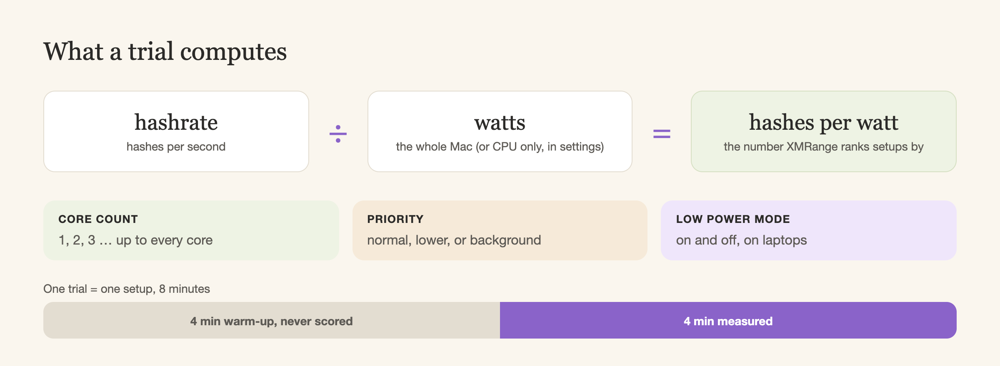
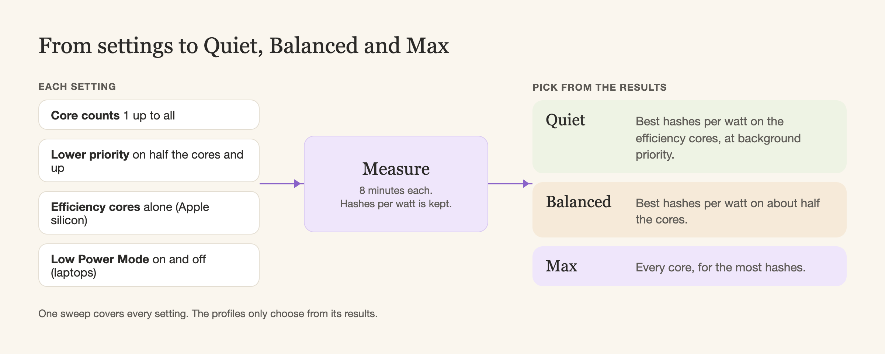
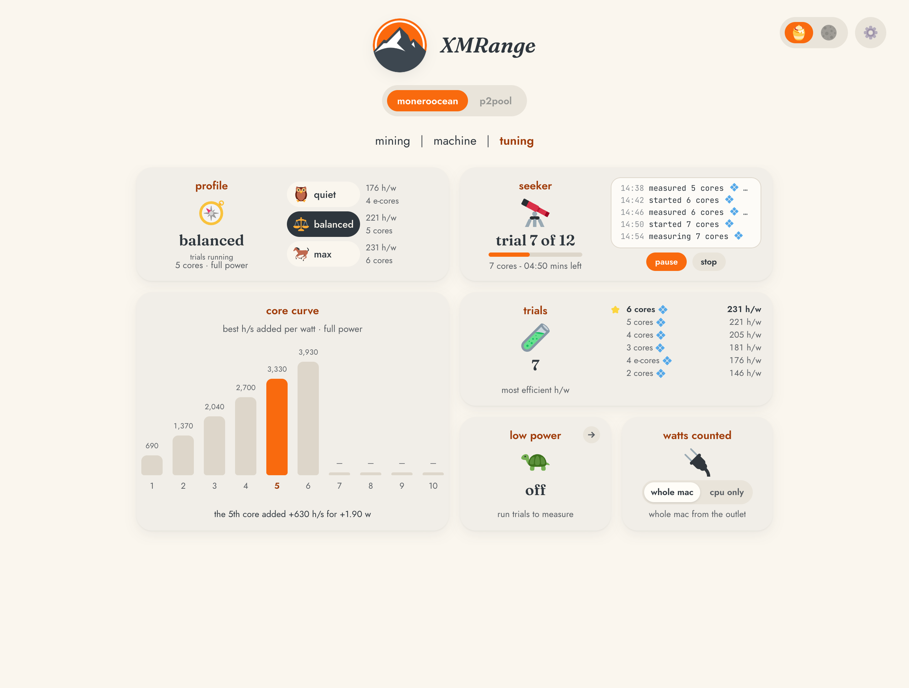

# Trials and profiles

Every Mac is different. So XMRange measures yours.

## Run trials

Open the **tuning** tab. The seeker card shows the button: **start trials** the first time, **continue trials** if you stopped part way, **run trials again** when all are done. If nothing is mining, it starts mining first. Close other apps first.

The card shows "trial N of M", the time left, and an estimate for the whole run. Expect a few hours on a Mac with many cores. You can **pause**, **stop** and later **continue**. Finished trials are kept. While trials run, your temperature and battery limits do not apply.

## Low Power Mode on laptops

On a laptop, the trials also run with Low Power Mode on and off. XMRange cannot switch it for you, since that needs administrator rights. So it asks: "turn it on in battery settings", with **skip** and **stop** beside it.

The **low power** card on the machine tab opens a short guide: **open battery settings**, select Low Power Mode, choose Always or Only on Power Adapter. A "detected" tick shows once macOS reports it on. Needs macOS 12 or later; on a Mac without it, the cards are hidden.

## The profiles

When trials exist, the **profile** card offers three pills, each with its h/w and setup. Before any trials the pills are off and the card says "run trials first". If you set cores by hand, it reads "manual · your own cores". The trials card lists every measured setup, best first. A row sets that setup directly.

## Limits

Both live in settings and apply to normal mining.

- **pause above:** a CPU temperature in °F, from 100 to 230. Blank means off. Mining pauses after the CPU stays at or over it for 30 seconds, and resumes after it stays a little under for 60 seconds. The tape says "paused · over your temperature limit".
- **mine on:** **battery too** (the default) or **adapter only**. With adapter only, mining pauses on battery ("paused · on battery") and resumes when you plug in. Desktop Macs do not show this row.

If you press resume yourself during a limit pause, that overrides it until the condition clears.
