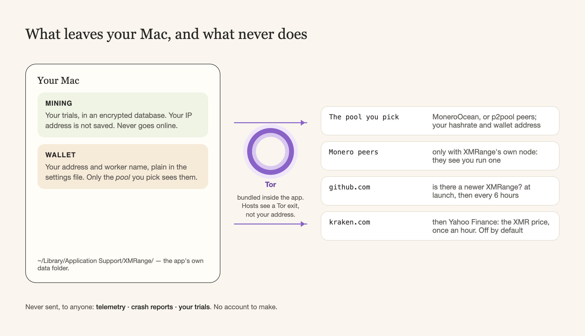
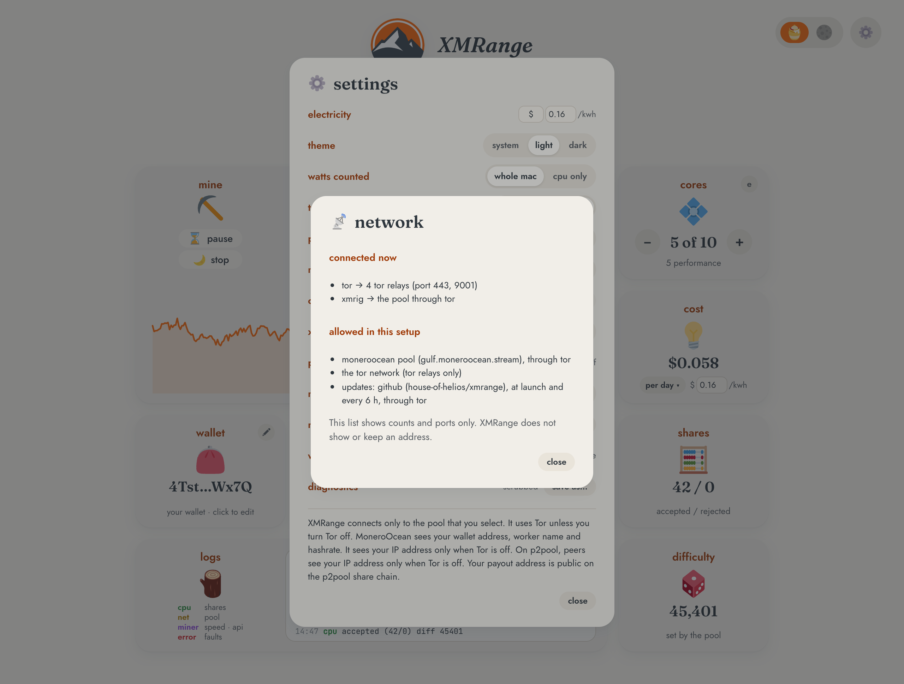

# Privacy

XMRange has no account, no analytics and no ads. It connects only to the pool you select, never both pools at once. This page lists everything that leaves your Mac, and says what does not.

## What leaves the Mac

| You choose | XMRange connects to | They see |
|---|---|---|
| moneroocean | the MoneroOcean pool | your wallet address, your worker name and your hashrate. Your IP address only if Tor is off. |
| p2pool | p2pool peers | your shares. Your payout address is public on the p2pool share chain. Your IP address only if Tor is off. |
| p2pool with XMRange's own node | p2pool peers and Monero peers | the same as above. Monero peers see that you run a node. |
| Tor on (the default) | the Tor network | a Tor connection, nothing more |
| xmr price **fetch** (off by default) | Kraken, then Yahoo Finance, through Tor | one price request each hour |
| update checks | GitHub, through Tor | a request for the latest release, at launch and every 6 hours. Nothing about you or your mining. |

The price fetch asks you first, and it always goes through Tor, even if you mine directly.

## Tor

The bundled Tor client is Arti, from the Tor Project. In settings, the **tor** row switches between **through tor** (the default) and **direct**. With Tor on, the pool or the p2pool peers see a Tor exit instead of your IP address.

## Show connections

Settings, **network**, **show connections**. It lists what is connected now and what this setup allows. It shows counts and ports only. XMRange does not show or keep an address.

<!-- screenshot: the network sheet with connected now and allowed in this setup -->

## Where things are kept

- **Your IP address** is not saved.
- **Trial results** are in an encrypted database. Its key is a private file in the app's data folder, not the Keychain. XMRange keeps trials only, not a second-by-second history.
- **Your wallet and worker name** are plain text in the settings file, since the pool sees them.
- **Diagnostics** are off until you save one. **save as** writes a text report where you choose, with no wallet, no IPs and no names.

## What never leaves

No telemetry. No crash reports. No sudo. Nothing from your Mac goes to anyone but the places in the table.
