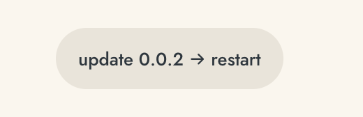

# Updates

XMRange updates itself from GitHub releases. You do not need to visit the page again.

## How it checks

At launch, then every 6 hours. If a check fails, for example when Tor or GitHub cannot be reached, it tries again in an hour.

Every check goes through Tor. GitHub sees a Tor exit and asks for one thing: the latest release. Nothing about you or your mining is sent.

## Installing

When a newer release is ready for your kind of Mac, a pill appears at the top left: **update 0.0.2 → restart** (with the new version number). Click it.

<!-- screenshot: the update pill in the top left corner -->

The pill then reads "update 0.0.2 · downloading", and the app does the rest. If mining was on, it stops cleanly, the new app takes its place, XMRange reopens, and mining resumes.

If something goes wrong, the pill stays and the logs say why. Your current app is left as it was.

## How it trusts an update

1. **A signature.** The release list is signed. XMRange checks the signature before it downloads anything. It also checks that the file is the one expected for your Mac, and that the version is newer.
2. **A checksum.** After the download, the file's SHA-256 must match the signed value. A wrong file is deleted.
3. **Unpack and copy.** The new app is copied beside the old one under a temporary name. Mining goes on meanwhile.
4. **A codesign check.** The copy must pass macOS's `codesign` check and carry the XMRange bundle identifier.
5. **The swap.** Only now does mining stop and the new app replace the old. If the swap fails, the old one is put back.

Apple and Intel builds never install each other's file.

The request is the same for everyone. GitHub learns that a Tor user asked for the latest release.
