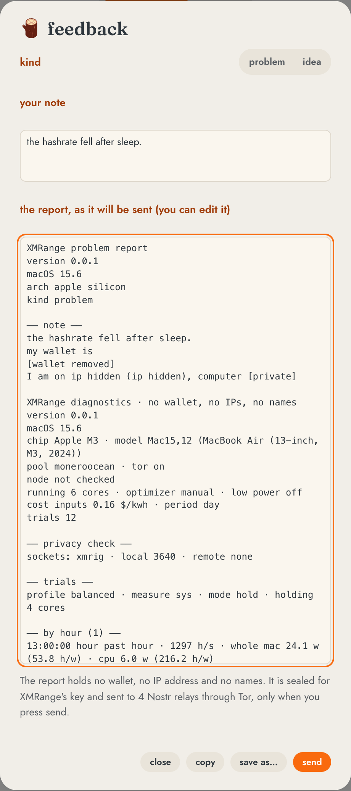
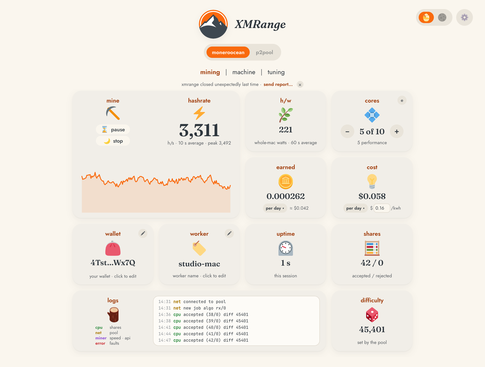
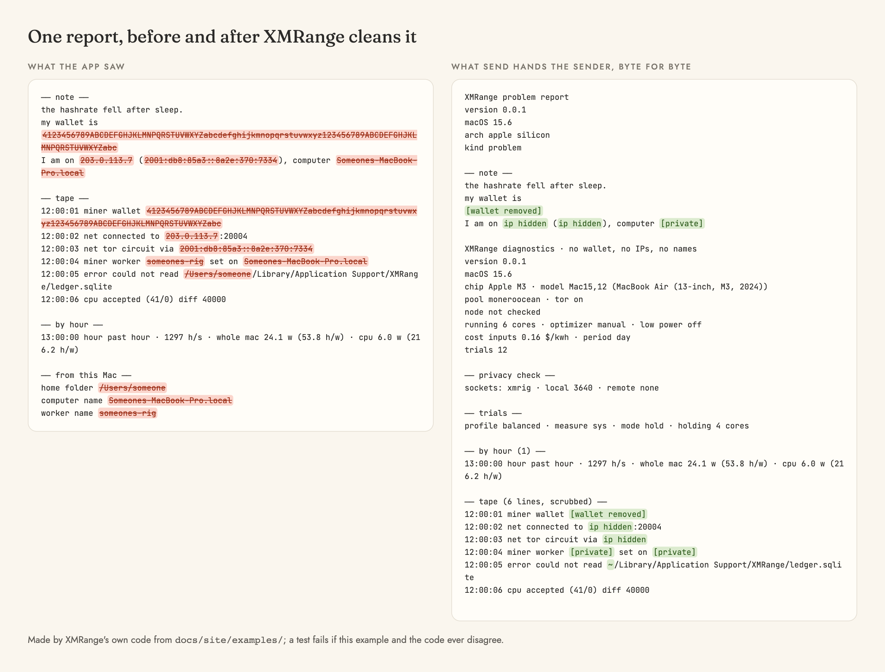

# Problem reports

Something wrong, or an idea? XMRange can write the report for you, show you every word of it, and send it only if you say so.

## How to report a problem

1. Open settings and choose **send feedback…**. If XMRange closed unexpectedly, it offers the same sheet the next time it opens: **send report…** in a line under the tabs (the **×** dismisses it, and nothing is sent).

   

2. Pick the kind (problem, idea, or crash after an offer) and write what happened under **your note**. The report below fills in as you type.
3. Read the report. Change or delete anything you like.
4. Press **send**, or **copy** or **save as…** to pass it on yourself. **close** sends nothing.

## What a report holds

The XMRange and macOS versions, the kind of Mac (Apple silicon or Intel), the chip and model, the pool and whether Tor is on, how many cores are running, your cost inputs, the number of trials, the last lines of the log, the hourly figures, and your note.

Before you see it, XMRange takes out your wallet address, IP addresses, your home folder (shown as `~`), the names of this Mac and your worker name. Names you type into the note yourself are removed only if they match this Mac's names. Anything else you typed is yours: the box shows it, and you can delete it before you press send.

## See it for yourself

Below is one report with a private thing of every kind planted in it: a wallet address, two IP addresses, a computer name, a home folder and a worker name. On the left is what the app saw, struck through in red. On the right is what send hands the sender, with the stand-ins in green: `[wallet removed]`, `ip hidden`, `[private]` and `~`.

XMRange's own code made both sides. The two files are in the repository, [examples/report-input.txt](examples/report-input.txt) and [examples/report-sent.txt](examples/report-sent.txt). A test checks them against the code every time, and fails if either one is out of date.

**What you see in the box is exactly what is sent, byte for byte.** Nothing is added or changed after you press send. The sender is `house-report`, and its source is public: [crates/house-report](https://github.com/House-of-Helios/xmrange/tree/main/crates/house-report), with the cleaning in [crates/xmrange-core/src/report.rs](https://github.com/House-of-Helios/xmrange/blob/main/crates/xmrange-core/src/report.rs).

## Where it goes

**send** seals the report with a key that belongs to XMRange alone, so only its makers can open it. It signs the report with a one-time key made for that one report, and hands it through Tor to four public Nostr relays: `nos.lol`, `relay.primal.net`, `relay.snort.social` and `nostr.mom`. The relays keep the sealed text for 30 days.

There is no account, no e-mail and no server of the House's own, and your IP address is never seen. If Tor is not connected, or no relay takes it, the sheet says so and nothing is sent; **copy** and **save as…** still work.

Send arrives in version 0.0.2. See [Privacy](06-privacy.md) for everything else that leaves the Mac.
